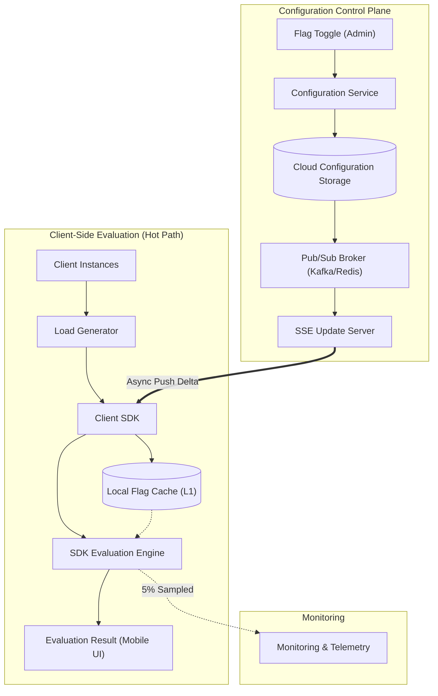

# PS 28 — Low-Latency Distributed Feature Flag Service Simulator

> **College System Design Microproject**  
> An interactive distributed-system simulator demonstrating sub-millisecond local feature-flag evaluations and push-based configuration distribution.

---

## 1. Executive Summary & Design Problem

Modern distributed applications rely heavily on feature flags for canary deployments, percentage rollouts, and kill switches. However, making a network roundtrip to a central database on every evaluation introduces unacceptable latency (30–100ms) and creates a catastrophic single point of failure (SPOF).

**PS 28 solves this problem by decoupling the architecture into two independent pathways:**

1. **Evaluation Path (Hot Path):**
   - Evaluations happen entirely **in-memory** within the embedded Client SDK and Local Flag Cache.
   - Latency: **~0.5ms – 1.5ms**.
   - Zero network dependencies on databases or message brokers during evaluation.
2. **Configuration-Update Path (Control Plane):**
   - Admin flag changes are saved in Cloud Storage, published via a Pub/Sub Broker, and pushed to connected clients via Server-Sent Events (SSE).
   - Latency: **~15ms – 45ms** push propagation time.
   - If the control plane fails, clients continue serving cached evaluations safely.

---

## 2. Architecture Overview



### Visual Color Coding in Simulator
- 🔵 **Blue Arrows:** Local Evaluation Requests flow (Client Instances → Load Generator → Client SDK → Local Cache / Evaluation Engine).
- 🟣 **Purple Arrows:** Configuration-Update Events flow (Admin Toggle → Config Service → Cloud Storage → Pub/Sub Broker → SSE Server → Client SDK Cache).
- 🟢 **Green Arrows:** Asynchronous 5% sampled telemetry reporting.

---

## 3. The 10 Modeled Components

| Component | Layer | Purpose | Base Capacity |
|---|---|---|---|
| **Client Instances** | Evaluation | Mobile apps, browsers & workers requesting flag evaluations | 12,000 req/s |
| **Load Generator** | Evaluation | Simulates ingress arrival rate and network gateway | 10,000 req/s |
| **Client SDK** | Evaluation | Embedded client library coordinating cache and evaluation rules | 8,000 req/s |
| **Local Flag Cache** | Evaluation | In-memory hash table providing sub-millisecond instant lookup (99.8% hit rate) | 12,000 req/s |
| **SDK Evaluation Engine** | Evaluation | Executes targeting rules, percentage rollouts, user bucketing | 6,000 req/s |
| **Configuration Service** | Control Plane | REST/gRPC API for mutating, validating, and auditing flag changes | 500 req/s |
| **Cloud Configuration Storage** | Control Plane | Durable database (DynamoDB / Postgres) storing state | 400 req/s |
| **Pub/Sub Broker** | Control Plane | Event bus (Kafka / Redis PubSub) broadcasting flag mutations | 2,500 ev/s |
| **SSE Update Server** | Control Plane | HTTP persistent streaming gateway holding active client connections | 4,000 push/s |
| **Monitoring** | Telemetry | Async telemetry collector tracking latency percentiles and errors | 2,000 req/s |

---

## 4. Mathematical Queueing & Latency Simulation Model

For every simulation tick $\Delta t$:
1. **Utilization:**
   $$U = \min\left(100,\; 100 \times \frac{L_{in}}{C}\right)$$
   Where $L_{in}$ is incoming load and $C$ is component processing capacity.
2. **Queue Buildup & Throughput:**
   - If $L_{in} > C$:
     $$\Delta Q = L_{in} - C$$
     $$Q = \min(Q_{max},\; Q + \Delta Q)$$
     Throughput is capped at $C$. Requests exceeding $Q_{max}$ are dropped (error rate rises).
   - If $L_{in} \le C$:
     Queue drains: $Q = \max(0,\; Q - (C - L_{in}))$.
3. **Queue Delay & Latency:**
   $$T = T_{base} + \left(\frac{Q}{C}\right) \times 1000\text{ ms} + \text{Network Delay}$$
   $$p95 \approx T \times \left(1.35 + \frac{Q}{200}\right)$$

---

## 5. Ready-To-Run College Presentation Scenarios

The simulator features 4 one-click presentation scenarios:

1. **Scenario 1: Normal Operation**
   - Moderate load (1,500 req/s, 1,000 clients).
   - All 10 components healthy.
   - Evaluations hit local cache in ~1.1ms; flag toggles propagate to the phone preview in ~25ms.
2. **Scenario 2: Traffic Spike**
   - Traffic surges to 7,500 req/s.
   - The Evaluation Engine (capacity 6,000 req/s) becomes the bottleneck ($U = 100\%$).
   - Queues grow, p95 latency spikes from 1.8ms to 25ms+, and error rate starts rising.
   - **Recovery:** Reduce traffic or use the Component Inspector slider to increase capacity.
3. **Scenario 3: Pub/Sub Broker Failure**
   - Injects failure into the Pub/Sub Broker.
   - Toggling the flag saves to Cloud Storage but stalls before reaching the SSE server.
   - Phone preview displays a **"Update Blocked / Stale"** badge and remains on the old UI.
   - **Key takeaway:** Normal evaluations continue uninterrupted at 1,500 evals/s from local cache!
   - **Recovery:** Restoring the broker delivers pending updates and synchronizes the phone.
4. **Scenario 4: Storage Failure**
   - Cloud Configuration Storage is marked as failed.
   - Admin flag changes fail with an error in the Event Log.
   - Local evaluation path remains 100% operational from cache.

---

## 6. How to Run and Test

### Development Server
```bash
npm install
npm run dev
```
Open [http://localhost:5173/](http://localhost:5173/) in any browser.

### Automated Acceptance Test Suite
Runs the 14 project acceptance criteria:
```bash
npm test
```

### Production Build
```bash
npm run build
```

---

## 7. UI Design Highlights
- **Strict Clean Light Theme**: White and slate-50 backgrounds, subtle borders, high legibility.
- **ShopEasy Mobile App Preview**: Realistic mobile phone preview with dynamic checkout UI reacting to `new_checkout` flag states.
- **Interactive Architecture Canvas**: SVG visualizer with live animated pulses, health indicators, zoom & fit controls, and click-to-inspect.
- **Live Dual SVG Charts**: Real-time Offered Load vs Throughput and Average Latency vs p95 Latency.
- **Interactive Component Inspector**: Real-time capacity sliders and manual failure injection/recovery buttons.
